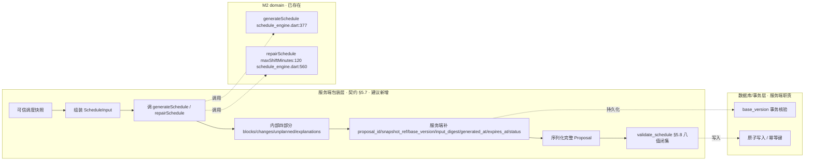

# A 轨真实后端接入 · 调度引擎集成映射（只读审计）

> 依据：M0 2026-11-03 07:36 邮件《M2：A轨真实后端接入的调度引擎集成映射（只读审计）》。
> 性质：**只读审计 + 独立工作区文档**。未改任何 Dart/Flutter 业务代码，未提交、未推送、
> 未创建/更新 PR，未触碰 M3 的 B 轨录制文件。
> 审计对象（2026-11-03，head `070fb6e`）：
> - `lib/features/agent_scheduler/domain/schedule_contract.dart`（633 行）
> - `lib/features/agent_scheduler/domain/schedule_engine.dart`（820 行）
> - `test/agent_scheduler_test.dart`（48 条用例）

---

## 一、domain 现状盘点（路径 · 符号 · 行号）

### 1.1 公开入口（只有 2 个）

| 入口 | 签名 | 位置 | 语义 |
|---|---|---|---|
| 从零排程 | `ScheduleProposal generateSchedule(ScheduleInput input)` | `schedule_engine.dart:377` | 从零排出一版提案，最早可行贪心 |
| 最小扰动重排 | `ScheduleProposal repairSchedule(ScheduleInput input, ScheduleProposal previous, {int? maxShiftMinutes})` | `schedule_engine.dart:560` | 硬约束变化后重排，只移被撞块；`maxShiftMinutes` 可选 |

引擎头注释（`schedule_engine.dart:1-13`）声明两条纪律：不 import repository/drift/UI；
不调用 `DateTime.now()`（时间基准全部来自 `ScheduleInput.now`）。

### 1.2 关键输入类型（`schedule_contract.dart`）

| 类型 | 符号 | 位置 | 关键字段与约束 |
|---|---|---|---|
| 排程输入 | `ScheduleInput` | `:311` | `now`（基准时刻）、`horizonStart/horizonEnd`、`baseVersion`（服务端可信版本，`:331-335`）、`timezone`（默认 `Asia/Shanghai`，`:317`）、`preferences`、`availability`、`fixedBlocks`、`demands`、`existingPlacements` |
| 任务需求 | `ScheduleTaskDemand` | `:237` | `taskId/title/requiredMinutes`（服务端可信快照，`:253-258`）、`taskKind`、`deadline`、`earliestStartAt`、`priority`、`targetDurationSeconds`、`remainingMinutesToday`（服务端可信快照，`:276-288`） |
| 硬约束 | `ScheduleFixedBlock` | `:215` | `ownerId/ownerType`（course/event，`:18-24`）、`startAt/endAt/title`；`window` getter `:230` |
| 偏好 | `SchedulePreferences` | `:83` | `dayStartMinute=480`、`dayEndMinute=1320`、`minimumBlockMinutes=15` |
| 截止 | `ScheduleDeadline` | `:174` | `dateOnly` / `exact` 两态互斥；`latestEndAt` `:194`；`isPast` `:206` |
| 时间窗口 | `ScheduleWindow` | `:152` | `contains/overlaps/duration/isEmpty` |
| 上一版安排 | `SchedulePlacement` | `:294` | `taskId/startAt/endAt/minutes` |

### 1.3 关键输出类型（`schedule_contract.dart`）

| 类型 | 符号 | 位置 | 说明 |
|---|---|---|---|
| 提案 | `ScheduleProposal` | `:597` | 只含四部分：`blocks/changes/unplannedTasks/notes`（`:624-629`） |
| 展示块 | `ProposedBlock` | `:360` | `blockId=blk-$taskId`、`source=proposal`、`persistableAs`、`durationSource`（`:392-416`） |
| 白名单变更（抽象） | `ProposedScheduleChange` | `:420` | 只有两种实现 |
| 单次事项变更 | `ScheduleOneTimeChange` | `:432` | `type=schedule_one_time`，Task 必须 one_time、时间同日、提案内唯一 |
| 单日例外变更 | `UpsertDailyOverrideChange` | `:463` | `type=upsert_daily_override`，`action=reschedule`，`existingOverrideId` 只能由可信读取服务提供 |
| 未排任务 | `UnplannedTask` | `:506` | `remainingMinutes/reason/reasonText`，JSON 恰好四项（`:528-533`） |
| 解释 | `ScheduleNote` | `:562` | `code/message/taskId`，`isPublic` `:576` |
| 未排原因枚举 | `UnplannedReason` | `:124` | 4 值：`windowInsufficient/pastDeadline/overlapsFixed/noAvailability`，code 映射 `:139-146` |

### 1.4 固定课程/会议约束

- `ScheduleFixedBlock` **永不可被移动**（`schedule_contract.dart:8`、`schedule_engine.dart:11`）。
- 引擎对硬约束重叠**只记录不解决**：`_overlappingFixedBlocks` `:146` → `FIXED_BLOCKS_OVERLAP` 解释 `:379-389`；
  固定块存在时产出 `PRESERVED_FIXED_EVENTS` `:392-399`。

### 1.5 任务重排规则

| 规则 | 实现 | 位置 |
|---|---|---|
| 需求排序：截止最紧 → 优先级 → taskId 兜底 | `_orderedDemands` / `_deadlineRank` | `:169-185` |
| 时长优先级：任务目标 > 服务端快照估算 > 兜底 `max(minBlock,30)` | `_durationOf` | `:209-235` |
| `remaining_minutes_today` 三态（>0 排该量 / =0 已完成不排 / null 按 target） | `_durationOf` `:213-218` + `generateSchedule` `:455-467` | 见下 |
| 最早可行放置（不拆分） | `_placeDemand` | `:238-268` |
| 就近重排（被撞块取最小位移，等距优先之后） | `_placeNearest` | `:278-331` |
| repair 保留未撞块 / 重排被撞块 | `repairSchedule` `:586-722` | 见下 |

### 1.6 错误 / 失败语义（`UnplannedReason` + 对应解释）

| 场景 | 原因码 | 解释码 | 位置 |
|---|---|---|---|
| 无可用窗口（availability 为空且无偏好窗口） | `noAvailability` | `NO_AVAILABILITY_WINDOW` | `:404-424` |
| 可用时段被课程/会议占满 | `overlapsFixed` | `AVAILABILITY_SATURATED` | `:427-447` |
| 截止已过（date_only 过当天 / exact 过点） | `pastDeadline` | （无独立解释码，直接入 unplanned） | `:474-485`、`:660-671` |
| 剩余时长不足 | `windowInsufficient` | （无独立解释码） | `:488-498`、`:686-696` |
| 当天已完成（remaining=0） | （不入 unplanned） | `ALREADY_DONE_TODAY` | `:455-467` |

### 1.7 序列化边界（方案 A，`schedule_contract.dart:591-596`）

M2 纯调度函数**只输出** `blocks/changes/unplanned_tasks/explanations` 四部分；
**不产出** `proposal_id/snapshot_ref/base_version/input_digest/generated_at/expires_at/status`。
这些服务端权威字段由包装层生成并持久化。

- 公共 explanation 码闭集 `kPublicExplanationCodes`（7 个）`:544-552`；
- repair 专用码 `kRepairOnlyExplanationCodes`（2 个：`DISPLACED_BY_FIXED`、`REPAIR_SUMMARY`）`:557-560`；
- `ScheduleProposal.publicExplanations` getter `:620-621` 已滤掉 repair 码与非枚举码。

---

## 二、集成映射表（现状 / 建议 / 未知）

| 能力 | 现状（已存在） | 建议（待接入时新增） | 未知（待 M0 定） |
|---|---|---|---|
| 调度计算 | ✅ `generateSchedule` / `repairSchedule` | — | — |
| 可信快照 → `ScheduleInput` 映射 | ❌ 无 | 服务端包装层组装（快照来源、`base_version` 产生方式） | 快照的具体字段来源与一致性范围 |
| 服务端权威字段（proposal_id/snapshot_ref/…） | ❌ 无（方案 A 明确由服务端） | 包装层生成并持久化 | `base_version` 与 `status` 的事务核验规则 |
| 序列化完整 Proposal | ❌ 无（M2 只序列化内部四部分） | 包装层组装完整 JSON | — |
| `maxShiftMinutes=120` 注入 | ⚠️ 参数已实现、domain 默认 null | 服务层调用时显式传 120 | 是否导出 `kDefaultMaxShiftMinutes` 常量 |
| 幂等 / 重复请求 | ❌ 无（scheduler 不负责） | 服务层（契约 §6.5 审批集合语义） | — |
| 部分失败恢复 | ❌ 无 | 服务层（契约 §6.7 三条恢复路径） | — |
| 校验（violations 八值闭集） | ❌ M2 不产出 violations | 服务端 `validate_schedule`（§5.8） | — |
| 服务层调用方 | ❌ 全仓无（已 grep 验证） | `lib/features/schedule/application/` 或契约 §5.7 包装层 | 具体文件/类名（不预建） |
| 时区解析 | ⚠️ `ScheduleInput.timezone` 字段存在但引擎未消费 | 服务层统一把时间转成本地 `DateTime` 再入参 | 时区边界语义（待 M0 确认） |

---

## 三、最小调用链图

现状：**没有任何生产调用方**，`repairSchedule` 全仓仅 domain 定义 + 测试调用（grep 证据）。

未来最小调用链（区分现状 ✅ / 建议新增 ⬜）：



文字版（现状 ✅ / 建议 ⬜）：

1. ⬜ 服务端从**可信快照**读取 Task/Course/Calendar/单日例外，映射成 `ScheduleInput`（`fixedBlocks`=课程+会议，`demands`=周期/单次任务）。
2. ⬜ 服务端调 `generateSchedule(input)`（从零）或 `repairSchedule(input, previous, maxShiftMinutes: 120)`（硬约束变化后）。
3. ✅ M2 引擎纯函数计算，返回 `ScheduleProposal`（内部四部分，确定性，无 IO）。
4. ⬜ 服务端用 `publicExplanations` 过滤 repair 专用码，补服务端权威字段，组装完整 Proposal。
5. ⬜ 服务端 `validate_schedule`（violations 八值闭集，含 `BLOCK_OVERLAP`）。
6. ⬜ 服务端/事务层按 `base_version` 做事务核验，原子写入，幂等键去重。

---

## 四、`maxShiftMinutes=120` 建议注入点（伪代码，不改实现）

```dart
// domain 层（已存在，不改）：
//   repairSchedule(input, previous, {int? maxShiftMinutes})  // 默认 null = 无边界
//   _placeNearest(...) 内：if (maxShiftMinutes != null && delta > maxShiftMinutes) continue;

// 建议：服务层接线时（入口出现后，与接入同一轮提交）——
// domain 层新增单一事实源常量（仅新增，不改算法）：
const int kDefaultMaxShiftMinutes = 120; // M0 2026-11-03 裁定，依据 C 扫描 [90,180]

// 服务层调用（伪代码，未来新增文件，M2 不越界建）：
final proposal = repairSchedule(
  input,
  previous,
  maxShiftMinutes: kDefaultMaxShiftMinutes, // 服务层默认 120
  // 显式调用方传值时按显式值（覆盖优先），不与默认合并
);
```

三边界（已在 `docs/scheduler/service-integration-maxshift.md` 详述）：
- **服务层默认 120**、**显式覆盖优先**、**domain 默认 null**；
- **新加入任务不得套阈值**：`_placeNearest` 只对 `originStartByTask` 中有原位置的块生效
  （`schedule_engine.dart:673-685`），新任务走 `_placeDemand` 最早可用，天然不受 `maxShiftMinutes` 影响；
- 无边界守卫已补（`test/agent_scheduler_test.dart` 第 48 条）。

---

## 五、风险与测试矩阵

| # | 风险 | 责任方 | 测试建议 | 状态 |
|---|---|---|---|---|
| R1 | 并发/重复请求导致重复写入 | 服务层（幂等键 approval_id，§6.5） | 同用户同 Proposal 重复请求返回同一 approval_id | 需真实后端 |
| R2 | 快照版本过期 / 数据漂移 | 服务层 + 事务（base_version 核验） | 传入旧 base_version 时被拒 | 需真实后端 |
| R3 | 固定事件变化后旧提案失效 | 服务层判断触发 repair | repair 保留未撞块、只移被撞块 | 已有（domain 用例） |
| R4 | 部分失败后重放（applying/readback_pending） | 服务层（§6.7 三条恢复路径，二次 apply 增量 0） | 恢复路径业务写入增量 0 | 需真实后端 |
| R5 | `requiredMinutes` 伪可信估算 | 服务层（只接受可信快照） | 非快照来源的 requiredMinutes 不进参 | 已有（contract 注释 + 用例语义） |
| R6 | 块与块重叠触发 §5.8 `BLOCK_OVERLAP` | scheduler（构造性不重叠）+ 服务端校验 | generate/repair 输出两两不重叠 | 已有（47 条里的两条守卫） |
| R7 | 截止语义误判（date_only vs exact） | scheduler | 三态 deadline 用例 | 已有 |
| R8 | 时区解析不一致 | 服务层统一转本地时间 | 同一时刻不同时区标签输出一致 | 缺失（待 M0 定语义） |
| R9 | 服务层默认 120 未生效 / 被 domain 默认吞掉 | scheduler + 服务层 | 显式 120 限制 + 不传参无边界 | 已有（第 48 条） |

状态列说明：**已有**=domain 层用例已覆盖（48/48）；**缺失**=可写但尚未有；**需真实后端**=必须等 A 轨真实后端/数据库才可验证。

---

## 六、推荐实施顺序 + 未决问题

### 6.1 按依赖排序的阶段（仅供 M0 排期参考，M2 不自行启动）

1. **P0 契约确认**：`scheduling_weight` tie-break 层级、时区解析语义、`base_version`/`status` 事务规则（待 M0 指位）。
2. **P1 服务层组装**：可信快照 → `ScheduleInput` 映射 + 服务端权威字段生成（建议新增，M2 提供 domain 对照基准）。
3. **P2 接线**：服务层调 `repairSchedule(maxShiftMinutes: 120)`，导出 `kDefaultMaxShiftMinutes` 常量（domain 小改，与接入同轮）。
4. **P3 校验与事务**：`validate_schedule`（§5.8）+ 幂等 + base_version 事务核验。
5. **P4 恢复路径**：§6.7 三条恢复路径 + 真实后端集成测试。

### 6.2 未决问题（需 M0 明确）

1. `scheduling_weight`（§5.2 仍 BLOCKED）插在 tie-break 链的哪一级？—— 未指位前 M2 不消费、不伪造。
2. `maxShiftMinutes` 服务层默认 120 何时落地（真实服务入口由谁建、落在哪个文件/类）？
3. 时区解析：`ScheduleInput.timezone` 字段引擎当前未消费，服务层如何统一转换？边界语义（跨时区 DST 等）？
4. `base_version` 的产生与校验规则、`status` 归属（服务端权威）的具体实现契约？

---

## 附：审计边界声明

- 本文件为**只读审计产出**，未改 `lib/`、未改 `test/`、未改契约本体。
- **未提交、未推送**，未创建/更新 PR，未触碰 PR #2/#3/#4 的 head。
- 未触碰 M3 的 B 轨录制文件；未把建议接口写成现有能力。
- 未参考 M1 的 A 轨准备清单结论（如到达会独立核验，不直接复制）。
